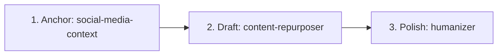
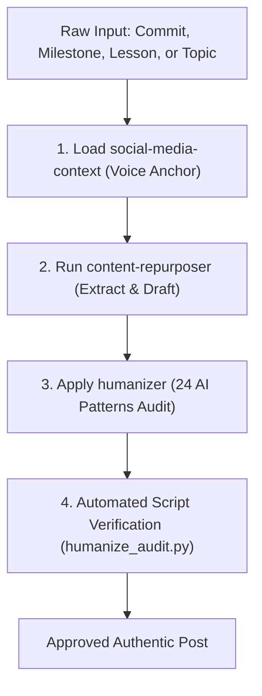

# LinkedIn Writer: High-Engagement, Authentic Human Voice

Transform technical achievements, git commits, messy development journeys, architectural lessons, and product milestones into compelling, viral LinkedIn updates that read like real human thoughts rather than automated corporate press releases.

---

## Core Philosophy: The Fusion of High Reach & True Voice

Standard AI-generated posts fail because they prioritize bland politeness and symmetry. Great posts achieve high retention and resonance by fusing two proven disciplines:
1. **The Viral LinkedIn Architecture** (Justin Welsh, Lara Acosta, Swyx): High-contrast hooks, generous whitespace, mobile-first scannability, and peer-inviting conclusions.
2. **The Medium Essayist Cadence** (Morgan Housel, Julie Zhuo, Tim Urban): First-principles simplicity, radical vulnerability, conversational rhythm ("Yo-Yo" sentence structure), and zero empty buzzwords.

---

## The 6 Non-Negotiable Rules of Human Voice

1. **Banish the Robot Vocabulary:**
   - Never use: *delve, tapestry, testament, spearhead, harness, leverage, paramount, game-changer, groundbreaking, ever-evolving, vibrant, foster, elevate, showcase, furthermore, moreover, in conclusion*.
   - Consult the [Anti-AI Field Guide](./references/anti_ai_field_guide.md) for full prohibited lists and human replacements.

2. **Hook in Under 140 Characters:**
   - Over 70% of readers view LinkedIn on mobile. Your opening 1–2 lines will be truncated with `...see more`.
   - Never start with throat-clearing pleasantries ("Excited to share", "Happy Monday").
   - Start *in media res* with a metric, an error, or a high-contrast belief.
   - Reference the [Hook and CTA Vault](./references/hook_and_cta_vault.md).

3. **Master Sentence Burstiness (The Yo-Yo Technique):**
   - Alternate between 3-word punchy sentences and 25-word narrative arcs.
   - Use one-line paragraphs for high-impact realizations.
   - Read the [Medium Cadence Guide](./references/medium_human_cadence.md).

4. **Ground Abstractions in Concrete Nouns & Dollar/Time Metrics:**
   - Replace *"We improved system resilience"* with *"We killed 14 slow database queries and dropped p99 latency from 840ms to 92ms."*

5. **Embrace Conversational Imperfections & Contractions:**
   - Write *don't, can't, it's, we've* instead of rigid full words.
   - Use em-dashes (—) and parentheses `( )` for honest asides and whispered admissions.

6. **End with a Peer Discussion Question, Not Lazy Engagement Bait:**
   - Ban *“Agree? Thoughts?”*
   - Ask a specific question inviting peers to share their battle scars.

---

## The Default 3-Skill Pipeline for LinkedIn Posts

To achieve authentic human resonance, LinkedIn post creation follows an integrated 3-stage modular pipeline:



| Step | Required Skill | Function & Output |
| :--- | :--- | :--- |
| **1. Anchor** | [`social-media-context`](../social-media-context/SKILL.md) | Enforces personal voice, developer positioning, 4 golden reference samples, audience pain points, and blacklisted buzzwords before drafting. |
| **2. Draft** | [`content-repurposer`](../content-repurposer/SKILL.md) | Ingests raw inputs (git commits, PR diffs, incident post-mortems, dev notes) and maps them into high-retention frameworks with mobile pacing. |
| **3. Polish** | [`humanizer`](../humanizer/SKILL.md) | Performs the anti-slop audit against 24 documented AI writing patterns (WikiProject AI Cleanup standards), fixes sentence burstiness, and strips robotic cliches. |

---

## Step-by-Step Post Generation Workflow


    D --> E["Anti-AI Vocabulary Scrub"]
    E --> F["Add Peer-Inviting CTA"]
    F --> G["Audit with audit_post.py script"]
```

### Step 1: Select the Post Archetype
Pick the best framework from the [Viral LinkedIn Swipe File](./references/viral_linkedin_swipe_file.md):
- **The Honest Metrics / Messy Middle:** Weekly build-in-public numbers, churn, honest realities.
- **The Expensive Mistake / Post-Mortem:** A production bug, broken assumption, or wasted sprint.
- **The Production War Story:** The 5 PM Friday bug, root cause diagnosis, and CI/CD fix.
- **The Contrarian Teardown:** Why common industry advice fails and what works instead.
- **The "Choose Your Hard" Contrast:** High-contrast solopreneur or engineering dilemmas.

### Step 2: Extract Grounded Substance
From the user's input, extract:
- **Numbers:** Time spent, revenue lost/gained, latency dropped, lines deleted.
- **Tools/Concepts:** Actual libraries, databases, or frameworks involved.
- **The Emotional Friction:** What was embarrassing, frustrating, or surprising?

### Step 3: Draft with Mobile Formatting
- Keep paragraphs to 1–2 sentences maximum.
- Use 1 blank line between all paragraphs.
- Use simple bullets (`•` or `-`) for lists.

### Step 4: Run the Anti-AI Scrub & Audit
Run the automated audit script on the draft:
```bash
python3 scripts/audit_post.py path/to/draft.md
```
Or pipe text directly:
```bash
echo "Your draft text..." | python3 scripts/audit_post.py
```
Ensure a score $\ge$ 80/100, zero prohibited words, and healthy burstiness.

---

## Reference Library

- [Viral LinkedIn Swipe File](./references/viral_linkedin_swipe_file.md): Verbatim examples and high-retention frameworks.
- [Medium Human Cadence Guide](./references/medium_human_cadence.md): Sentence architecture, conversational asides, and authentic voice.
- [Anti-AI Field Guide](./references/anti_ai_field_guide.md): The exhaustive catalog of LLM cliches and surgical human rewrites.
- [Hook and CTA Vault](./references/hook_and_cta_vault.md): 50+ tested hooks and conversational discussion closers.
- [Git Commit to Viral Post Walkthrough](./examples/git_commit_to_viral_post.md): Real-world before-and-after demonstration.
- [Technical Deep Dive Example](./examples/technical_deep_dive_post.md): Explaining complex architecture clearly.
- [Vulnerability & Lessons Example](./examples/vulnerability_and_lesson.md): Authentic setback and recovery narrative.
